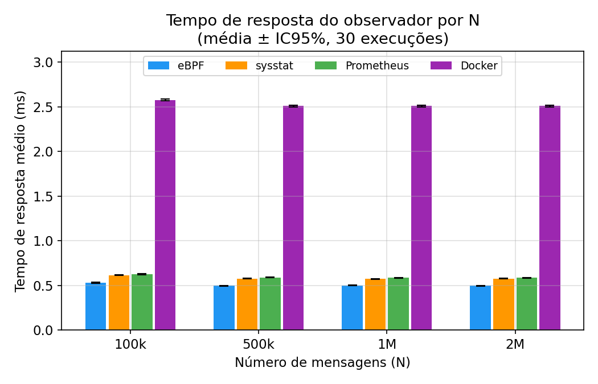
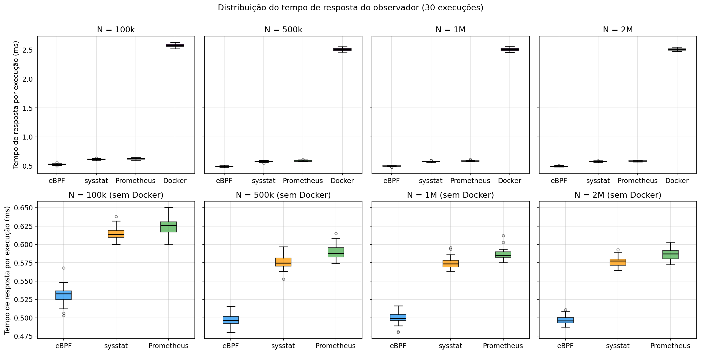
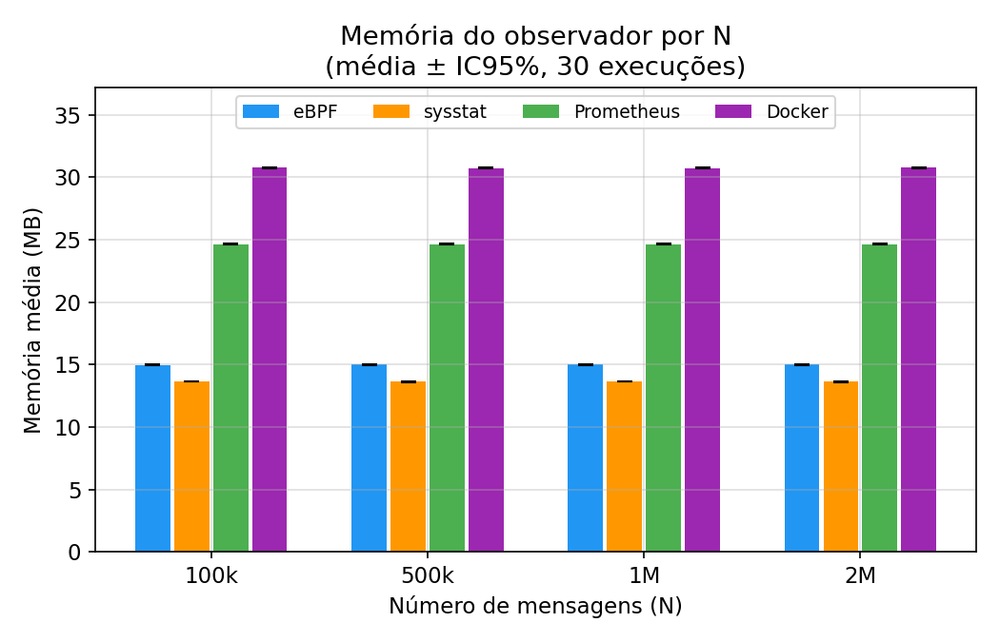
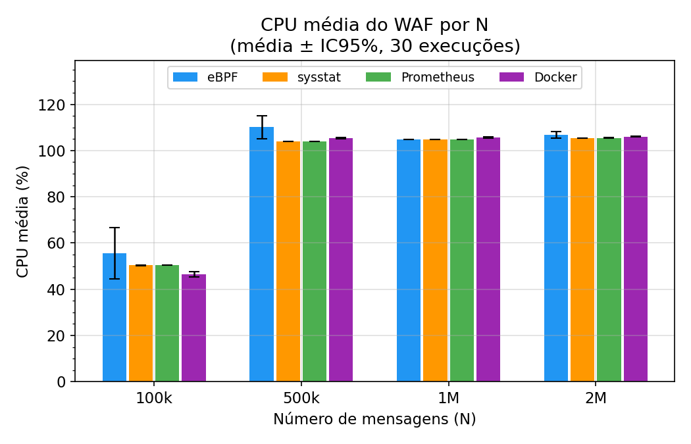

# Resultados

960 execuções em duas baterias: 480 oficiais (4 ferramentas × 4 volumes × 30 repetições) e 480 complementares, com o WAF inspecionando 100% de N (veja [Coleta complementar](#coleta-complementar-100-de-n-inspecionado)). As tabelas por volume são da coleta oficial, coletada em 08–09/10/2026 (kernel 7.0.0-38, Docker Engine 29.8.2, modo texto, WORKERS=200, libbpf+CO-RE). Esta é a recoleta com o WAF corrigido (escrita atômica de `waf_metrics.json`). A primeira coleta de 480 execuções (mesmo ambiente, com 106 resumos de inspeção zerados e recalculados) está em [`results/arquivo_primeira_coleta/`](../results/arquivo_primeira_coleta), e a de 360 execuções (kernel 7.0.0-15, sem o Docker) em [`results/arquivo_kernel15/`](../results/arquivo_kernel15).

Valores exibidos como **média ± IC95%** (intervalo de confiança de 95%, t de Student, α=0,05). Em **negrito**, o menor valor médio de cada linha; isso não significa diferença estatisticamente significativa (veja as [observações](#observações)).

## Comparativo cross-N — tempo de resposta médio (ms)

| N | eBPF | sysstat | Prometheus | Docker |
|---|------|---------|------------|--------|
| 100.000 | **0.5331** | 0.6137 | 0.6225 | 2.5789 |
| 500.000 | **0.4964** | 0.5714 | 0.5832 | 2.5027 |
| 1.000.000 | **0.4980** | 0.5750 | 0.5845 | 2.4978 |
| 2.000.000 | **0.4995** | 0.5725 | 0.5837 | 2.5055 |

## N nominal × mensagens processadas

O volume N é o tamanho nominal do arquivo de payloads. Cada execução termina após `DURATION` segundos, e a vazão real do WAF é menor que os 15 mil msg/s assumidos na fórmula. Por isso o WAF processa só uma fração de N nos volumes maiores (média de `inspect_count` por execução, última amostra):

| N nominal | eBPF | sysstat | Prometheus | Docker |
|---|---|---|---|---|
| 100.000 | 100.000 (100%) | 100.000 (100%) | 100.000 (100%) | 100.000 (100%) |
| 500.000 | 439.877 (88%) | 421.340 (84%) | 421.650 (84%) | 439.470 (88%) |
| 1.000.000 | 706.407 (71%) | 689.070 (69%) | 689.610 (69%) | 701.667 (70%) |
| 2.000.000 | 1.246.773 (62%) | 1.232.790 (62%) | 1.234.400 (62%) | 1.248.430 (62%) |

> Na primeira coleta, 106 das 480 execuções (N ≥ 500k) vieram com `inspect_count = 0` por uma condição de corrida na leitura de `waf_metrics.json` (o WAF gravava o arquivo sem escrita atômica). O WAF foi corrigido (commit `c7b305e`) e a coleta foi repetida; nesta recoleta nenhuma execução tem `inspect_count = 0`. Os RTT e a memória das duas coletas coincidem dentro do IC95% nos 16 grupos; a CPU do WAF difere em até ~0,9 p.p.

## Resultados por volume

### N = 100.000

DURATION ≈ 26 s, 26 amostras por execução.

| Métrica | eBPF | sysstat | Prometheus | Docker |
|---------|------|---------|------------|--------|
| Tempo de resposta médio (ms) | **0.5331 ± 0.0029** | 0.6137 ± 0.0046 | 0.6225 ± 0.0035 | 2.5789 ± 0.0108 |
| Desvio padrão (ms) | **0.0631 ± 0.0032** | 0.0740 ± 0.0026 | 0.0810 ± 0.0032 | 0.2076 ± 0.0113 |
| CPU média WAF (%) | 46.481 ± 7.539 | 50.667 ± 0.105 | 50.884 ± 0.231 | **46.200 ± 1.020** |
| Memória média WAF (MB) | 28.929 ± 0.100 | 28.179 ± 0.074 | 28.138 ± 0.109 | **20.819 ± 0.117** |
| CPU média observador (%) | 2.967 ± 5.969 | **0.061 ± 0.009** | 5.054 ± 7.086 | 0.696 ± 1.193 |
| Memória média observador (MB) | 14.982 ± 0.020 | **13.641 ± 0.019** | 24.654 ± 0.052 | 30.761 ± 0.050 |

### N = 500.000

DURATION ≈ 53 s, 53 amostras por execução.

| Métrica | eBPF | sysstat | Prometheus | Docker |
|---------|------|---------|------------|--------|
| Tempo de resposta médio (ms) | **0.4964 ± 0.0032** | 0.5714 ± 0.0026 | 0.5832 ± 0.0042 | 2.5027 ± 0.0099 |
| Desvio padrão (ms) | **0.0504 ± 0.0026** | 0.0613 ± 0.0042 | 0.0577 ± 0.0021 | 0.1728 ± 0.0087 |
| CPU média WAF (%) | 109.344 ± 5.783 | 104.468 ± 0.029 | **104.466 ± 0.036** | 106.274 ± 0.333 |
| Memória média WAF (MB) | 36.647 ± 0.210 | 35.789 ± 0.210 | 35.809 ± 0.187 | **30.209 ± 0.232** |
| CPU média observador (%) | **0.047 ± 0.004** | 2.497 ± 3.472 | 0.061 ± 0.004 | 0.787 ± 0.954 |
| Memória média observador (MB) | 15.001 ± 0.019 | **13.626 ± 0.018** | 24.653 ± 0.052 | 30.755 ± 0.047 |

### N = 1.000.000

DURATION ≈ 86 s, 86 amostras por execução.

| Métrica | eBPF | sysstat | Prometheus | Docker |
|---------|------|---------|------------|--------|
| Tempo de resposta médio (ms) | **0.4980 ± 0.0023** | 0.5750 ± 0.0042 | 0.5845 ± 0.0028 | 2.4978 ± 0.0107 |
| Desvio padrão (ms) | **0.0495 ± 0.0014** | 0.0650 ± 0.0173 | 0.0602 ± 0.0063 | 0.1692 ± 0.0097 |
| CPU média WAF (%) | 106.094 ± 1.556 | **105.300 ± 0.024** | 105.303 ± 0.030 | 106.052 ± 0.252 |
| Memória média WAF (MB) | 40.930 ± 0.290 | 39.800 ± 0.258 | 40.069 ± 0.299 | **33.950 ± 0.249** |
| CPU média observador (%) | 1.619 ± 2.245 | **0.834 ± 1.593** | 2.299 ± 3.388 | 1.330 ± 0.919 |
| Memória média observador (MB) | 15.002 ± 0.023 | **13.648 ± 0.021** | 24.661 ± 0.051 | 30.737 ± 0.034 |

### N = 2.000.000

DURATION ≈ 153 s, 153 amostras por execução.

| Métrica | eBPF | sysstat | Prometheus | Docker |
|---------|------|---------|------------|--------|
| Tempo de resposta médio (ms) | **0.4995 ± 0.0024** | 0.5725 ± 0.0024 | 0.5837 ± 0.0021 | 2.5055 ± 0.0080 |
| Desvio padrão (ms) | **0.0480 ± 0.0012** | 0.0557 ± 0.0034 | 0.0558 ± 0.0036 | 0.1658 ± 0.0085 |
| CPU média WAF (%) | 106.724 ± 1.227 | **105.922 ± 0.019** | 105.924 ± 0.016 | 106.402 ± 0.144 |
| Memória média WAF (MB) | 46.459 ± 0.485 | 46.188 ± 0.474 | 46.280 ± 0.477 | **40.531 ± 0.528** |
| CPU média observador (%) | 0.557 ± 1.038 | 0.926 ± 1.244 | 0.920 ± 1.224 | **0.209 ± 0.189** |
| Memória média observador (MB) | 15.003 ± 0.020 | **13.628 ± 0.020** | 24.656 ± 0.049 | 30.779 ± 0.047 |

## Coleta complementar (100% de N inspecionado)

Na coleta oficial (1 processo de WAF e 1 de cliente), o WAF sustenta 7 a 8 mil msg/s, abaixo dos 15 mil assumidos na fórmula de `DURATION`, e inspeciona só 62% a 88% de N para N ≥ 500k. Para separar esse efeito, investigou-se o gargalo com o eBPF e N = 1 milhão (`scripts/sensibilidade.py`; dados em `results/sens_cli4/`, `results/sens_waf4cli4/` e `results/exp_*/`):

| Configuração | WAF | Cliente | Inspeções (média) | % de N |
|---|:---:|:---:|---:|---:|
| Original (coleta oficial, 30 repetições) | 1 proc. | 1 proc. | 706.407 | 71% |
| Cliente com 4 processos (30 repetições) | 1 proc. | 4 proc. | 601.527 | 60% |
| WAF e cliente com 4 processos (30 repetições) | 4 proc. | 4 proc. | 650.067 | 65% |
| Cliente com leitura direta (3 repetições) | 1 proc. | 1 proc. | 736.000 | 74% |
| Leitura direta e cliente com 4 processos (3 repetições) | 1 proc. | 4 proc. | 734.367 | 73% |
| **WAF e cliente com 4 processos e leitura direta (30 repetições)** | 4 proc. | 4 proc. | **1.000.000** | **100%** |

Multiplicar só o cliente não ajuda, porque cada processo percorre o arquivo de payloads inteiro. O gargalo são dois fatores juntos: o WAF com 1 processo e a leitura dos payloads pelo *thread pool*. Só a combinação dos três ajustes (`WAF_PROCESSES=4`, `CLIENT_PROCESSES=4` e `CLIENT_DIRECT_READ=1`) leva a 100%. As variantes com 3 repetições não permitem intervalo de confiança e servem só como indício.

Com essa configuração, repetiu-se a bateria inteira (480 execuções, dados em `results/otimizada/`). O WAF inspecionou 100% de N em todas as execuções. **Tempo de resposta médio (ms), coleta oficial → complementar (± IC95% da complementar):**

| N | eBPF | sysstat | Prometheus | Docker |
|---|------|---------|------------|--------|
| 100.000 | 0.5331 → **0.8999** ± 0.0070 | 0.6137 → 1.0183 ± 0.0079 | 0.6225 → 1.0305 ± 0.0111 | 2.5789 → 2.6453 ± 0.0098 |
| 500.000 | 0.4964 → **0.9029** ± 0.0065 | 0.5714 → 1.0115 ± 0.0059 | 0.5832 → 1.0352 ± 0.0061 | 2.5027 → 2.6476 ± 0.0096 |
| 1.000.000 | 0.4980 → **0.9002** ± 0.0045 | 0.5750 → 1.0140 ± 0.0042 | 0.5845 → 1.0369 ± 0.0050 | 2.4978 → 2.6584 ± 0.0088 |
| 2.000.000 | 0.4995 → **0.9021** ± 0.0037 | 0.5725 → 1.0161 ± 0.0047 | 0.5837 → 1.0370 ± 0.0040 | 2.5055 → 2.6500 ± 0.0081 |

A **ordem entre as ferramentas se mantém** (eBPF < sysstat < Prometheus < Docker) e o IC95% fica estreito (±0,004 a ±0,011 ms). O aumento de ~0,4 ms no eBPF, no sysstat e no Prometheus vem do `psutil` consultar os 4 processos do WAF a cada sonda, em vez de 1; o Docker consulta o contêiner por uma única chamada e sobe pouco. A memória do observador é a mesma da coleta oficial. Por isso os valores absolutos da coleta oficial, com 1 processo, são os que se reportam.

## Observações

- **Tempo de resposta:** o eBPF lidera nos quatro volumes, com IC95 sem sobreposição em relação às demais: 13% abaixo do sysstat, 14–15% abaixo do Prometheus e ~80% abaixo do Docker. Sysstat e Prometheus também ficam separados (1,4% a 2,1%).
- **Docker:** ~2,5 ms, cerca de cinco vezes o eBPF. A consulta ao daemon (socket Unix → dockerd → cgroup → JSON) está dentro do RTT medido. Na decomposição isolada (`scripts/bench_docker_cgroup.py`), ler `cpu.stat` e `memory.current` direto de `/sys/fs/cgroup` leva ~0,04–0,05 ms, uma requisição vazia ao daemon (`/_ping`) ~0,5–0,6 ms e `stats(one_shot=True)` ~1,4–1,7 ms (~30× a leitura direta): o custo está no caminho até o `dockerd`, não no cgroup. Usar a leitura direta como coletor e o cache em segundo plano não foram avaliados.
- **N=100k:** todos os coletores têm RTT maior que nos demais volumes; a partir de 500k o RTT é praticamente constante.
- **CPU do observador é inconclusiva:** médias baixas com desvios muito altos; os IC95 do sysstat, do Prometheus e do Docker são da ordem da média ou incluem o valor do eBPF.
- **Memória do observador:** sysstat ~14 MB, eBPF ~15 MB (libbpf, sem BCC/LLVM), Prometheus ~25 MB, Docker ~31 MB, estável em todos os volumes.
- **CPU do WAF:** equivalente entre as ferramentas; a partir de 500k o WAF satura em torno de 104–110%. No Docker a CPU vem do cgroup, não do psutil.
- **Memória do WAF:** no Docker é a do cgroup (`usage − inactive_file`), ~6–8 MB abaixo do RSS das demais; não é comparável.
- **Bytes RX/TX:** eBPF mede só o tráfego da porta 8080; sysstat, Prometheus e Docker medem todo o `lo` (via `/proc/net/dev`); servem só para caracterização.

## Gráficos

Gerados por `scripts/plot_results.py` a partir das médias das 30 execuções (arquivos em `results/plots/`).

